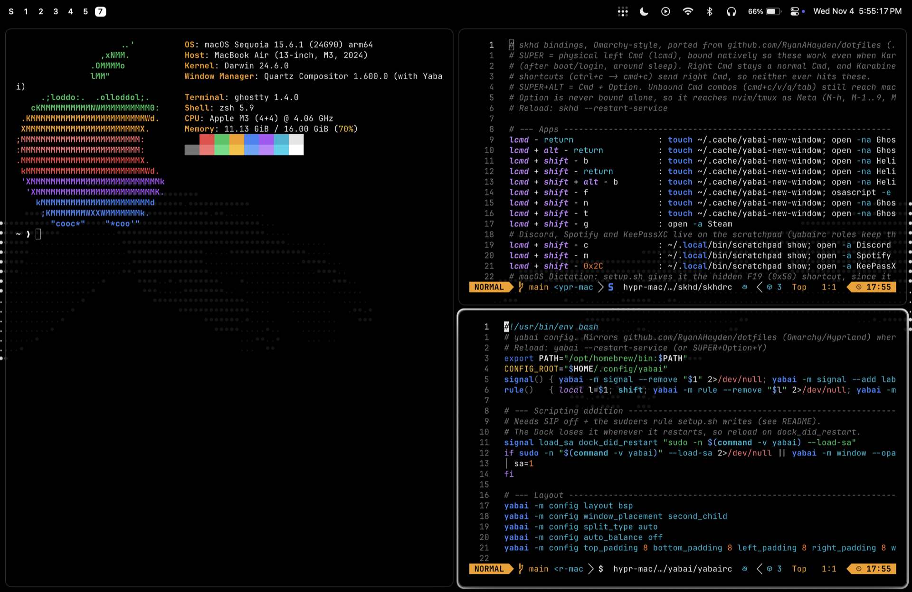

# hypr-mac

My [Omarchy](https://omarchy.org) setup, rebuilt on macOS: the same keys, workspaces and look as my Linux
[dotfiles](https://github.com/RyanAHayden/dotfiles), in the ryha-silver colors.



- **Tiling** with yabai and skhd. SUPER is left Cmd, and the binds follow Omarchy's
- **Instant workspaces** (1-10, plus a scratchpad), with no macOS slide. Alt-tab, minimize and fullscreen stay
  on the workspace you're on
- **Workspace bar** in the top left of the menu bar, drawn by a small native helper (`yabai-helper`)

  
- **Linux-style keys** via Karabiner: Caps Lock is Ctrl, and Ctrl+C/V/S work in GUI apps
- **One command**: `./setup.sh` installs everything, stows the configs into `~`, applies the macOS settings and,
  with SIP off, grants every permission up front, so nothing prompts

Built from yabai, skhd, JankyBorders, Karabiner-Elements, Ghostty, LazyVim and zsh. Everything is a plain config
file stowed into `~`. Older setups are in git history.

## Setup

1. **Turn SIP off first** (optional, but do it before running setup). Recovery (hold power at boot > Options >
   Utilities > Terminal):

   ```sh
   csrutil disable
   nvram boot-args=-arm64e_preview_abi
   ```

   Reboot. With SIP off, setup writes every privacy permission straight into the TCC databases (Ghostty/Terminal
   get everything, plus yabai, skhd, AltTab, MiddleClick, Karabiner and scripting System Events), so you don't
   click through Allow prompts. It also disables `systemstatusd` (the purple/orange privacy dots), adds a sudoers
   rule so yabai loads its scripting addition (instant Space switching, Space creation, swapping, opacity), and
   creates the 11 Desktops. `csrutil enable` in Recovery turns SIP back on.
2. `./setup.sh` - installs packages, stows using --adopt so you can see git changes before discarding what you
   want to change, and applies the macOS settings, dark mode and wallpaper. Re-run it after upgrading yabai or
   skhd (the sudoers rule and permissions pin the binaries). It also turns off automatic macOS update
   downloads/installs (security responses still install): check yabai supports a new macOS before upgrading, and
   install minor updates by hand from Software Update ("Other updates" lists same-major ones).
3. Approve Karabiner-Elements' driver (General > Login Items & Extensions) and log out/in. With SIP on you also
   have to do the rest by hand: grant Accessibility (yabai, skhd, AltTab, MiddleClick), Input Monitoring
   (Karabiner-Core-Service), give Ghostty and Terminal every Privacy & Security permission (Full Disk Access,
   Accessibility, Input Monitoring, Screen Recording, App Management, Developer Tools), re-run setup.sh from
   Ghostty (silences AltTab's monthly screen recording prompt) and add 11 Desktops in Mission Control.

## Keys (Cmd = SUPER, Cmd+Option = SUPER+ALT)

Modifiers are laid out like Linux, via Karabiner-Elements (`.config/karabiner/karabiner.json`):

| Physical key | Becomes | Used for |
|---|---|---|
| Caps Lock | Ctrl | Same as Ctrl |
| Ctrl | Linux-style Ctrl | Ctrl+C/V/S/T/W/F/Z/1..0... = Cmd+... in GUI apps (not Ctrl+H: Cmd+H hides the app), Ctrl+arrows/Backspace = word jump/delete, Home/End = line start/end. Real Ctrl in Ghostty/Terminal (copy/paste there is Ctrl+Shift+C/V) |
| Option | Alt | Never bound by skhd, so nvim/tmux get Meta (M-h, M-1..9, M-Enter) from either side |
| Cmd | SUPER | All window manager binds (skhd). Unbound Cmd combos still reach apps: Cmd+C/V/X, Cmd+Q (Cmd+Tab is AltTab) |
| Fn+H/J/K/L | Arrows | Everywhere, Shift works for selecting |

SUPER is physical left Cmd, bound natively by skhd (`lcmd`), so binds keep working when Karabiner isn't running
(right after boot/login, around sleep/wake). Right Cmd is a normal Cmd, and Karabiner's Ctrl shortcuts send right
Cmd, so Ctrl+S saves instead of firing SUPER+S. If Ctrl shortcuts stop working, `fixkeys` (or "Fix Keyboard" in
Raycast) restarts Karabiner. Screenshots move to Ctrl+Shift+3/4/5 (Ctrl+Option+Shift+3/4 to
the clipboard) and Spotlight's Cmd+Space goes to Raycast. Full list: `.config/skhd/skhdrc` (Cmd+I shows it).

| Key | Action |
|---|---|
| Cmd+Return / Cmd+Option+Return | Ghostty / Ghostty in tmux `Work` |
| Cmd+Space | Raycast (its own hotkey, so it toggles) |
| Cmd+Tab / Cmd+Shift+Tab | AltTab (window switcher with previews), replacing the macOS app switcher |
| Cmd+Shift+B / Return / Option+B | Helium / new window / incognito |
| Cmd+Shift+F, N, T | new Finder window, nvim, btop |
| Cmd+Shift+C, M, / | Discord, Spotify, KeePassXC, on the scratchpad (their windows always open there) |
| Cmd+Option+Space | macOS Dictation (setup gives it a hidden F19 shortcut) |
| Cmd+W / Cmd+Shift+W | close / force kill |
| Cmd+M / Cmd+Option+M | minimize (instant: parked on hidden Space 12) / bring back the latest |
| Cmd+H/J/K/L, Shift+H/J/K/L | focus / move (warp) |
| Cmd+1..0, Shift+1..0 | Space / move window to Space |
| Cmd+A/D, Shift+A/D | prev/next Space / move window there |
| Cmd+F, Cmd+T, Cmd+\ | fullscreen (blue border, no hover focus; stays on the workspace, so focusing another window fullscreens that one), float, toggle split |
| Cmd+O | pop window out: float centered, on every Space, above tiled windows (again: put back) |
| Cmd+Ctrl+F | tiled fullscreen (fill its split only) |
| Cmd+Option+F | native macOS fullscreen. Its Desktop belongs to the workspace it came from (`.local/bin/fs-origin`): "F" right after it in the bar, Cmd+A/D cycle through it there, and that workspace's number reaches it (when it has no other windows, or press it again) |
| Cmd+-/= (+Shift, +Option, +Ctrl) | resize width (Shift: height; Option: a little, Ctrl: a lot) |
| Cmd+Backspace, Option+Backspace / Shift+Option+Backspace | unfocused windows see-through on/off (on by default; the focused one stays opaque), more / less |
| Cmd+Shift+Backspace | toggle gaps and borders on every Space |
| Cmd+Option+L / Shift+Option+L | cycle Space layout bsp -> stack -> float / back |
| Cmd+G, Cmd+Option+arrows | group (yabai stack) with neighbour / ungroup, move window into the group that way |
| Cmd+Option+Tab, Cmd+Ctrl+Left/Right | next/prev window in the group |
| Cmd+S / Cmd+Option+S | scratchpad (11th Space, "S" in the bar): go there and back / send window there (from it: back) |
| Cmd+Shift+Option+1..0 | move window to that Space without following it |
| Cmd+Ctrl+Tab | back to the previous Space |
| Cmd+Ctrl+Shift+H/J/K/L or arrows | move window to the display that way |
| Ctrl+Option+Tab (+Shift) | focus next (previous) display |
| Cmd+Shift+Option+arrows | move the whole Space to the display that way (renumbers Spaces) |
| Cmd+Ctrl+M | mirror displays (macOS Cmd+F1) |
| Cmd+Escape | system menu (native, centered): lock, sleep, keep awake with lid closed, reopen apps at login (off by default), relaunch yabai/skhd, log out, restart, shut down. Also in Raycast as "Power: ..." |
| Cmd+Ctrl+V / Cmd+Ctrl+E | Raycast clipboard history / emoji picker |
| Opening a text/code file | nvim in a new Ghostty window (setup makes `~/Applications/Nvim.app` the default with duti; never TextEdit, except RTF) |
| Raycast "Create App Shortcut" | makes `~/Applications/<Name>.app` that opens a file/folder/URL or runs a shell command, launchable from Raycast |
| Cmd+Ctrl+B / W / P | Bluetooth / Wi-Fi / Battery menu from the menu bar |
| Cmd+Ctrl+N | toggle Night Shift (`.local/src/night-shift.swift`) |
| Cmd+Ctrl+C | capture menu: macOS screenshot/recording toolbar |
| Cmd+, / Cmd+Shift+, | dismiss the newest notification / clear all (`.local/bin/notifications`) |
| Cmd+Ctrl+, , Cmd+Shift+Option+, | Notification Center (history) |
| Cmd+/ , Cmd+Option+/ | display scaling: bigger / more space, through the Retina "Looks like" sizes (`.local/src/display-scale.swift`) |
| Cmd+Ctrl+D, Cmd+Shift+Q | Displays settings, Calculator |
| Cmd+Shift+I, Ctrl+Shift+I | promote to largest, mirror split |
| Cmd+Shift+Space | toggle menu bar auto-hide (the workspace bar hides with it) |
| Cmd+Shift+S | screenshot: select an area, copied to the clipboard (Ctrl+Shift+4 saves to a file) |
| Cmd+Ctrl+S | Sound panel from the menu bar (output device, volume) |
| Option+Tab / Option+Shift+Tab | cycle focus through the windows on this workspace, floating ones too (Cmd+Tab is AltTab, all windows) |
| Hover | focuses the window under the mouse and brings it to the front (yabai `focus_follows_mouse autoraise`) |
| Cmd+drag / right-drag | move / resize window (yabai takes Cmd+click; three-finger middle click opens links in a new tab) |
| F4 / F5 | keyboard brightness down / up (instead of Spotlight / Dictation) |
| Fn+F1…F12 | plain function keys for apps: setup turns off macOS's Show Desktop (F11) and Dashboard (F12) shortcuts |
| (off) | hot corners, Sequoia drag-to-edge tiling, click-wallpaper-to-show-desktop, Ctrl+Space input switching (tmux prefix), Cmd+Option+Space Finder search, Ctrl+arrows (Mission Control, Desktop left/right), Ctrl+F1…F8 keyboard navigation, Fn+Ctrl+arrows window tiling, reopening apps after restart/log out (toggle in the Cmd+Escape menu) |

## Workspace bar

The workspaces are drawn over the left side of the menu bar (Apple and app menus, up to the notch; on every display)
by `yabai-helper` (`.local/src/yabai-helper.swift`, built to `~/.local/bin/yabai-helper`, run by the
`com.ryha.yabai-helper` LaunchAgent). Clicks pass through it, and it disappears while the mouse is over it or a menu
opened from the bar is showing, so the Apple and app menus stay usable.

yabai-helper also does the focus fixes, natively and over yabai's socket (no bash/jq per event, so a few ms):
when focus moves to another window (new window, alt-tab, close) and the mouse isn't in it, it moves the mouse there,
so hover focus doesn't hand focus back; after a close, minimize or quit it focuses the next window on the Space
(macOS leaves focus on nothing); and it does the instant alt-tab jump across Spaces (scripting addition only).
yabai signals ping it with `notify-post` (`.local/src/notify-post.c`; `notifyutil` takes ~100 ms).

Workspaces 1-9 and 10 sit on SUPER+1..0; SUPER+A/D cycle through them and wrap around. SUPER+M doesn't use macOS minimize (its ~300 ms animation can't be turned off): yabai-helper parks the window on
hidden Space 12 instantly, and it comes back to the workspace you're on with SUPER+Option+M, by switching to its app
(Dock, Cmd+Tab, Raycast) or by picking it in AltTab. Real minimize (yellow button) still works: the window is kept sticky while
minimized, so restoring it brings it up on the current workspace.
The scratchpad is the 11th Space (`.local/bin/scratchpad`): a normal tiled workspace where Discord, Spotify and
KeePassXC live, drawn as "S" first in the bar (while you're on it or it has windows) and skipped by SUPER+A/D.
Workspaces 1-5 always show, higher ones when occupied; current = white pill, occupied = white, empty = grey.

SUPER+Shift+P pauses/resumes yabai entirely (`.local/bin/yabai-pause`): yabai owns SUPER(Cmd)+drag and can't tell
left Cmd from right, so this is how Cmd-drag reaches macOS. While paused nothing tiles, the bar stops updating,
workspace keys fall back to the slower macOS switch (1-9 only), and alt-tab won't jump to other Spaces.

## Shell

`.zshrc` ports Omarchy's `default/bash` (emacs keys like readline) plus the Linux `.bashrc`:

| | |
| --- | --- |
| Up / Down | history matching what's typed so far (`ssh`↑ → `ssh rycs`) |
| Tab / Shift+Tab | case-insensitive completion menu, forward / back; `**`Tab = fzf picker (`vim **`, `cd **`) |
| Ctrl+R / Ctrl+T / Alt+C | fzf history / insert file / cd into dir |
| `cd x` | normal cd, falls back to zoxide (most used dir matching `x`); `z`, `zi` work too |
| `ls` `lsa` `lt` `lta` | eza long / all / tree / tree all |
| `ff` `eff` `sff host:dir` | fzf with bat preview / open pick in nvim / scp pick |
| `n` `g` `d` `c` `t` | nvim (`.` with no args), git, docker, claude, tmux attach-or-new `Work` |
| `gcm` `gcam` `gcad` `ga` `gd` | git commit -m / -a -m / -a --amend, new worktree+branch / remove it |
| `fip host port…` `dip port…` `lip` | ssh port forwards: start / stop / list |
| `compress dir` `decompress f` | tar.gz |
| `ssh` | resets mouse/alt-screen junk after a drop and reconnects sessions that were up 30s+ |

Ctrl+X Ctrl+E opens the command line in nvim. Prompt is starship with the Linux `.config/starship.toml`, in silver (#e5e5e5, the border colour) instead of cyan.

## Sacrifices vs Omarchy

- With SIP on (see above for turning it off), no yabai scripting addition: Space switching goes through macOS ctrl+N (slide animation;
  Accessibility > Reduce motion makes it a fade), Desktops are created by hand, and window opacity, pop out (sticky/on top),
  scratchpad toggle-back, silent moves, previous Space and moving Spaces between displays don't work (they need the SA).
- No pseudo-tiling, Quake console, notification binds, save/restore width, window labels.
- Raycast is trimmed down by setup (compact window, AI and upsell commands off, script folder added):
  `.config/raycast/settings.sql` is written into its encrypted settings database. Raycast has to have been opened
  once first. To change it, flip things in Raycast Settings and re-dump its `raycastConfiguration` table.
- Not ported (Linux/desktop only): gaming (stretched res, MangoHud caps, gamescope, crosshair, xpadneo), Sunshine,
  sddm/limine/plymouth, TPM2, reboot-to-windows, GPU toggle, monitor mirror/TV/pin, focus lock, window labels,
  per-window volume, SUPER+scroll zoom (use Accessibility > Zoom with a modifier), `clds` (Linux sudo wrapper). `c` runs `cld` (claude, bypass permissions, auto-trusts $PWD).
- Substitutes: Dolphin -> Finder, wiremix/bluetui -> System Settings, quickshell switcher -> AltTab,
  voxtype -> macOS Dictation, bash -> zsh (`.zshrc`), Waybar -> native menu bar + top-left workspace overlay.
- Menu bar is pitch black because Reduce transparency is off and the wallpaper's top edge is black (macOS 15 has
  no menu bar colour setting; Reduce transparency makes it solid grey). A wallpaper with a lighter top shows through.
- Syncthing runs always (brew service) instead of being bound to a mount.
